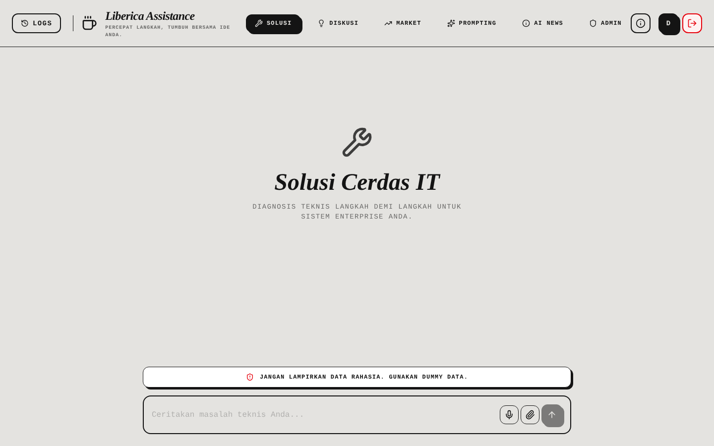
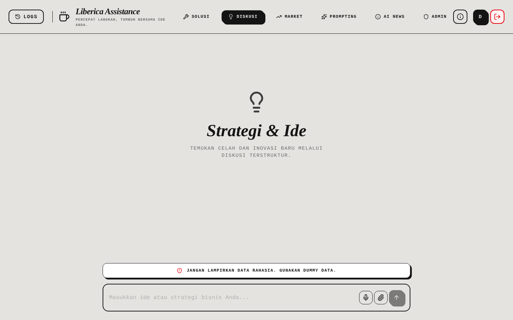
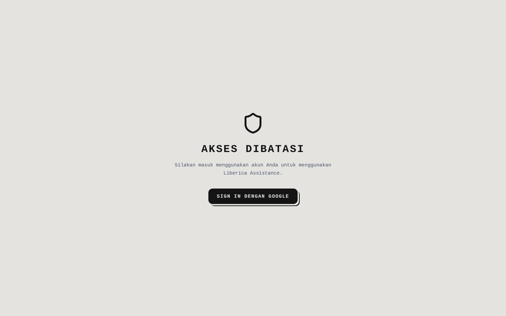

# Liberica Assistance

[English](README.md) · **Bahasa Indonesia**

Liberica Assistance adalah asisten AI untuk troubleshooting teknis, brainstorming bisnis yang terstruktur, dan analisis pasar. Aplikasi ini berjalan di atas Google Gemini, menyimpan sesi chat setiap pengguna di Firebase, dan awalnya dibangun di Google AI Studio (rilis saat ini: versi 1.2). Antarmukanya berbahasa Indonesia.


## Daftar isi

- [Tangkapan layar](#tangkapan-layar)
- [Mode](#mode)
- [Fitur](#fitur)
- [Teknologi](#teknologi)
- [Memulai](#memulai)
- [Konfigurasi](#konfigurasi)
- [Build dan menjalankan produksi](#build-dan-menjalankan-produksi)
- [Struktur proyek](#struktur-proyek)
- [Catatan keamanan](#catatan-keamanan)
- [Lisensi](#lisensi)

## Tangkapan layar



*Mode Solusi (troubleshooting)*

| | |
|:---:|:---:|
| <br/>Mode Diskusi (brainstorming) | <br/>Halaman login Google |

## Mode

| Menu | Mode | Fungsi |
|---|---|---|
| Solusi | `troubleshoot` | Penyelesaian masalah teknis langkah demi langkah dengan analisis akar masalah |
| Diskusi | `brainstorm` | Diskusi bisnis dan strategi bertahap. Asisten mengajukan pertanyaan kritis sebelum mengusulkan arah, dan menampilkan progress bar per fase |
| Market | `market` | Analisis aset dan komoditas dengan data harga terkini, widget TradingView, dan grafik |
| Prompting | `chat` | Percakapan umum |
| AI News | `news` | Kumpulan berita AI dengan gambar sampul yang dibuat otomatis |
| Admin | `admin` | Pengelolaan daftar admin, hanya terlihat oleh akun admin |

Semua mode memakai system prompt yang sama: model diminta mengklarifikasi permintaan yang ambigu, menyusun rencana sebelum mengerjakan tugas bertahap, memeriksa ulang jawabannya, dan menjawab secara ringkas.

## Fitur

- Pemilihan model otomatis: prompt sederhana dikirim ke `gemini-3-flash-preview`, prompt kompleks ke `gemini-3.1-pro-preview`. Bila kuota habis, request dicoba sekali lagi dengan `gemini-2.5-flash` atau `gemini-2.5-pro`.
- Google Search grounding untuk jawaban yang membutuhkan informasi terbaru.
- Lampiran: `.txt`, `.csv`, `.md`, `.pdf`, `.docx`, dan gambar. PDF dibaca dengan pdf.js, file Word dengan mammoth, dan gambar dikompres ke JPEG sebelum diunggah.
- Jawaban kaya format: Markdown, tabel, blok kode dengan tombol salin, dan grafik.
- Ekspor percakapan ke PDF.
- Login Google melalui Firebase Authentication. Sesi disimpan per pengguna di Firestore dan bisa diganti nama serta disematkan (pin).
- Data pasar diambil lewat endpoint Express kecil, `GET /api/stock/price/:ticker`, yang meneruskan permintaan ke Yahoo Finance sehingga browser tidak memanggilnya langsung.
- Dashboard admin untuk menambah dan menghapus email admin di koleksi Firestore `admins`. Super admin tidak bisa dihapus.

## Teknologi

| Lapisan | Teknologi |
|---|---|
| Frontend | React 19, TypeScript, Vite 6, Tailwind CSS 4, motion, lucide-react |
| AI | `@google/genai` (Gemini) |
| Data dan autentikasi | Firebase Authentication (Google), Cloud Firestore |
| Server | Express 4 lewat `tsx` saat development, di-bundle dengan esbuild untuk produksi |
| Data pasar | Yahoo Finance chart API, `react-ts-tradingview-widgets`, recharts |
| Dokumen | pdfjs-dist, mammoth, jsPDF, html2pdf.js, html-to-image |

## Memulai

Prasyarat: Node.js 20 atau lebih baru, API key Gemini, dan project Firebase dengan Google sign-in serta Firestore yang sudah aktif.

```bash
npm install
cp .env.example .env.local     # lalu isi GEMINI_API_KEY
npm run dev
```

`npm run dev` menjalankan `server.ts`, yang menyajikan aplikasi Vite dan API di `http://localhost:3000`.

Pengaturan Firebase dibaca dari `firebase-applet-config.json`. Untuk memakai project sendiri, ganti file tersebut dengan konfigurasi web app project Anda dan deploy `firestore.rules`.

## Konfigurasi

| Variabel | Wajib | Keterangan |
|---|---|---|
| `GEMINI_API_KEY` | ya | API key Gemini. Disisipkan ke bundle frontend saat build oleh `vite.config.ts` |
| `APP_URL` | tidak | URL publik aplikasi. Diisi otomatis oleh AI Studio di Cloud Run |
| `DISABLE_HMR` | tidak | Isi `true` untuk mematikan hot module reload (dipakai di AI Studio) |

## Build dan menjalankan produksi

```bash
npm run build                    # vite build + bundle server.ts ke dist/server.cjs
NODE_ENV=production npm start    # node dist/server.cjs di port 3000
```

`NODE_ENV=production` wajib diisi. Tanpa itu server mencoba menjalankan middleware dev Vite, bukan menyajikan `dist/`.

Skrip lain:

| Skrip | Fungsi |
|---|---|
| `npm run preview` | Pratinjau frontend hasil build dengan Vite |
| `npm run lint` | Pemeriksaan tipe dengan `tsc --noEmit` |
| `npm run clean` | Menghapus `dist/` |

## Struktur proyek

```
server.ts                 server Express: proxy Yahoo Finance + middleware static/Vite
index.html
src/
  App.tsx                 navigasi mode dan layout
  constants.ts            system prompt dan placeholder per mode
  firebase.ts             inisialisasi Firebase
  services/aiService.ts   pemanggilan Gemini, pemilihan model, prompt per mode
  hooks/useSessions.ts    login dan penyimpanan sesi di Firestore
  components/             UI chat, jawaban kaya format, AI news, dashboard admin
  utils/                  parsing file unggahan, ekspor PDF
firestore.rules           aturan keamanan Firestore
security_spec.md          invariant data dan payload yang wajib ditolak aturan
```

## Catatan keamanan

- `GEMINI_API_KEY` ikut ter-compile ke bundle frontend, sehingga siapa pun yang membuka aplikasi bisa membacanya. Batasi key di Google Cloud (pembatasan HTTP referrer dan API), atau pindahkan pemanggilan Gemini ke `server.ts` sebelum rilis publik.
- `firestore.rules` membatasi setiap dokumen sesi hanya untuk pemiliknya di `/users/{userId}/sessions`, mewajibkan skema yang persis, batas ukuran, dan timestamp server, serta hanya mengizinkan satu jenis perubahan per penulisan. [security_spec.md](security_spec.md) mencantumkan payload yang dirancang untuk ditolak.
- Jangan masukkan `.env.local` ke version control.

## Lisensi

Repositori ini belum menyertakan file lisensi. Hubungi pengembang sebelum menggunakan ulang kode ini.

Dikembangkan oleh Yohanes Octavian Rizky ([@torpedoliar](https://github.com/torpedoliar)).
